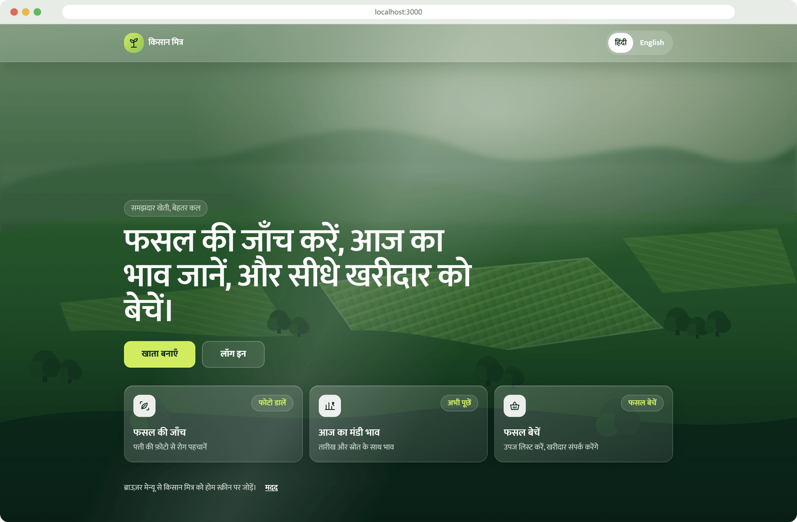
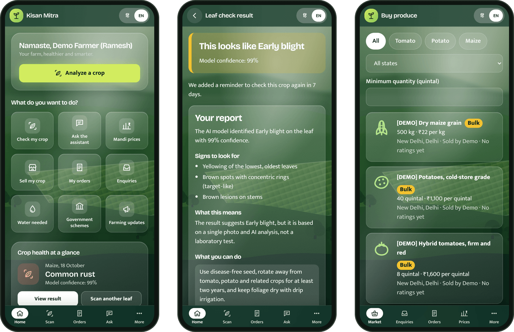
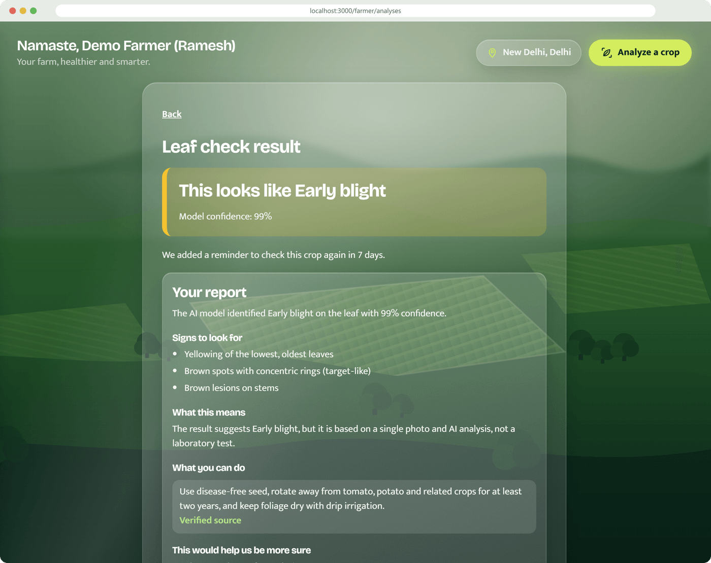
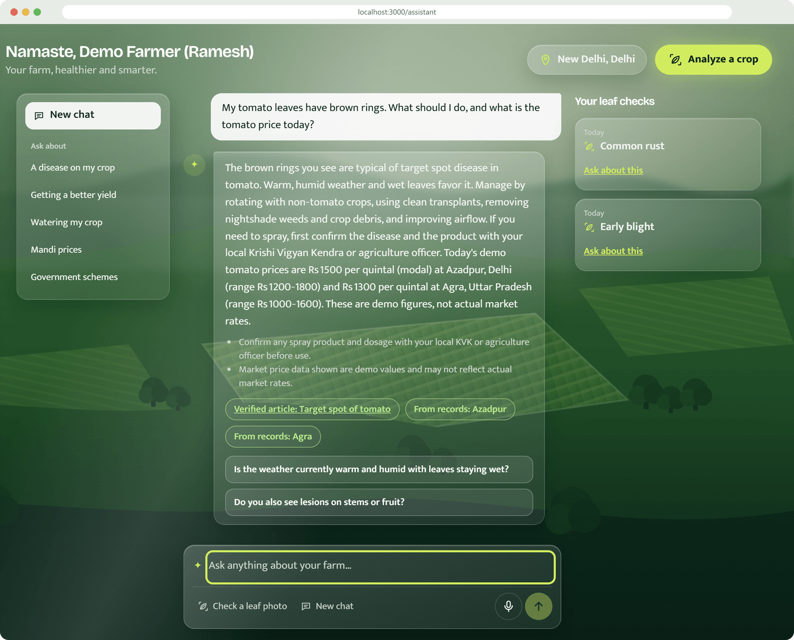
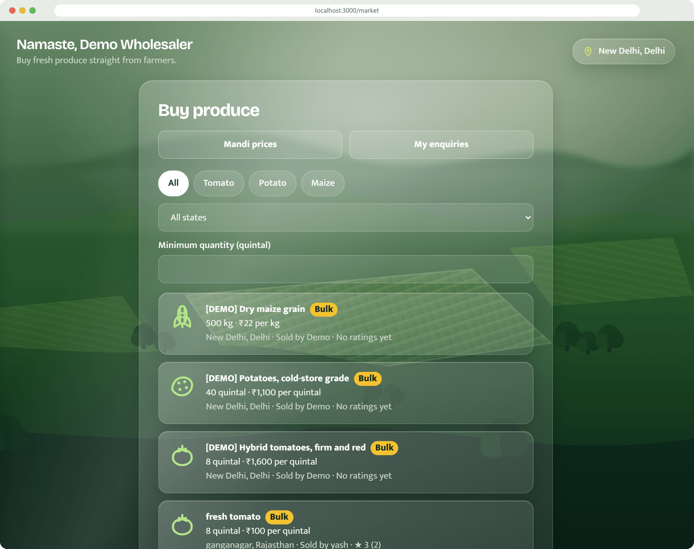
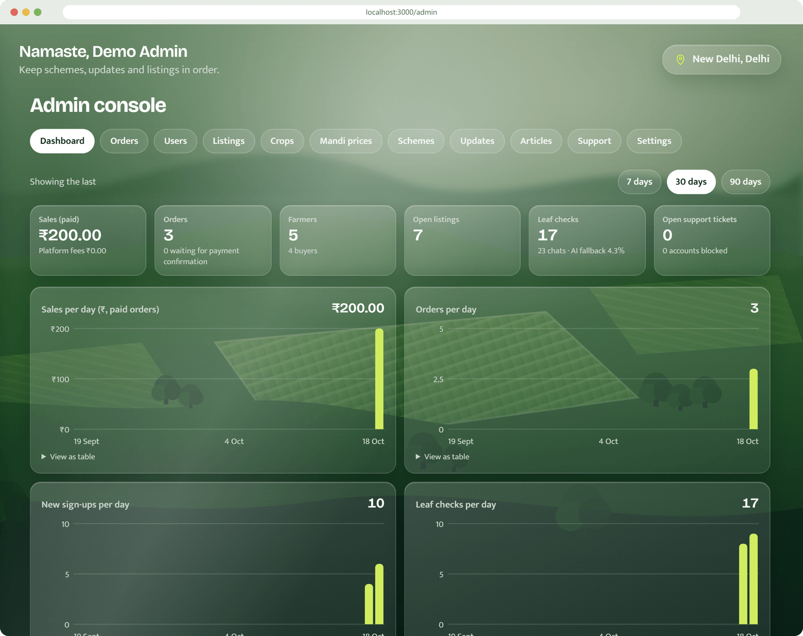
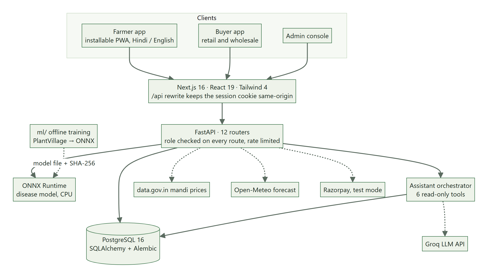
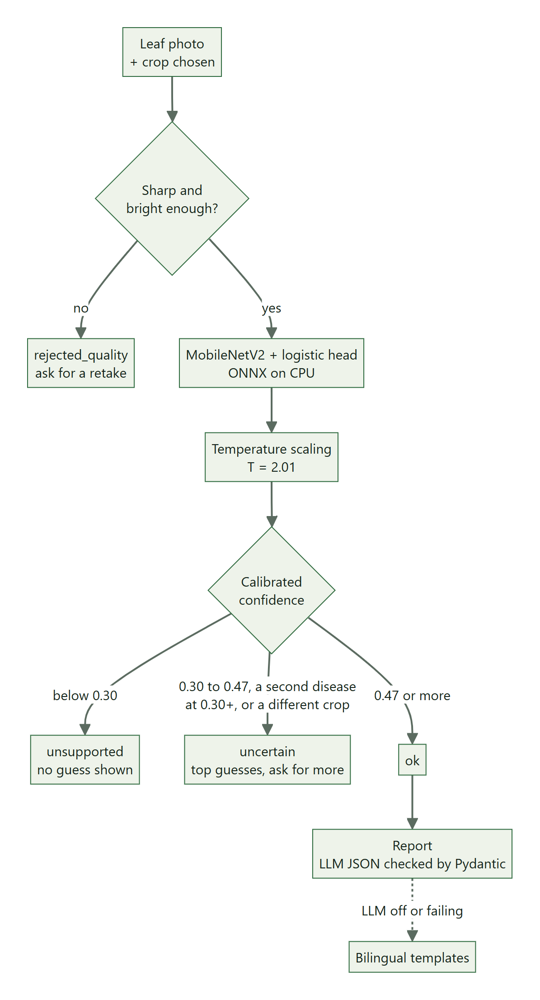
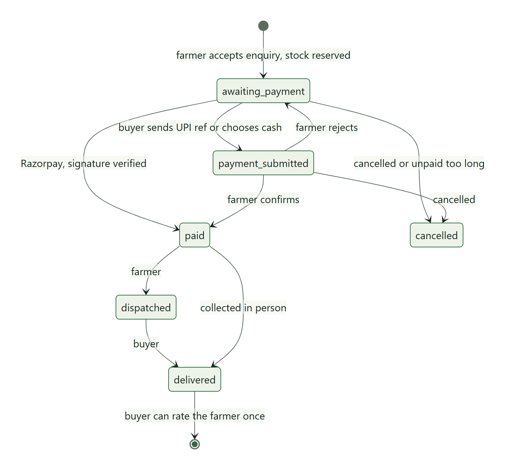

# Kisan Mitra · किसान मित्र

**Check a crop, know today's mandi price, and sell straight to the buyer. In Hindi or English.**

Team VexelThorn · IIIT Delhi Hackathon · Agriculture & Rural Development track



A smallholder usually makes four decisions with very little help: is the crop sick, how much should I water, what will it sell for, and who will buy it. Kisan Mitra is one web app that helps with all four. A farmer photographs a leaf and gets a likely disease, a confidence score and a plain-language report. They can ask an assistant follow-up questions, see sourced mandi prices, get a weekly water estimate, and list the harvest for buyers to order and pay for directly.

It is a working app, not a mock-up. Every screenshot below comes from this repository running locally.

---

## What it does

| | What the farmer sees | How it works |
|---|---|---|
| **Leaf check** | Photo in, "This looks like Early blight, 99%" out, plus what to look for and what to do | MobileNetV2 features + logistic regression, exported to ONNX and run on CPU inside the API. 17 classes across tomato, potato and maize. |
| **Farmer report** | A short report with symptoms, meaning, next steps and links to verified articles | The LLM (Groq) writes JSON, Pydantic validates it. If the LLM is down or no key is set, Hindi/English templates take over. |
| **Assistant** | Chat in Hindi or English, by text or voice | The LLM can call six read-only tools. The server validates every call and scopes it to the logged-in user. |
| **Mandi prices** | Today's min / max / modal price by market, with date and source | data.gov.in (AGMARKNET) when a key is set, cached for 6 h. Otherwise admin-entered prices. Demo rows are always labelled as demo. |
| **Water estimate** | Litres needed this week for each crop | FAO-56 crop coefficient × Open-Meteo reference evapotranspiration, minus 80% of the forecast rain, over 7 days. Always labelled an estimate. |
| **Marketplace** | List a crop, receive enquiries, accept, get paid, dispatch, get rated | Full order state machine with stock reservation, Razorpay test-mode payments (HMAC verified), UPI and cash, numbered receipts. |
| **Schemes and updates** | Government schemes and farming advisories | Published by admins. Links must be https, and every article carries its source. |
| **Admin console** | Dashboard, users, listings, crops, prices, schemes, support, settings | Platform fee, payment methods, unpaid-order timeout and the assistant switch are settings, not code. |

## Screens

<p align="center">
  
</p>

| Leaf check result | Assistant answering from records |
|---|---|
|  |  |
| **Buyer marketplace** | **Admin dashboard** |
|  |  |

---

## Architecture

<p align="center"></p>

A few decisions worth explaining:

- **No CORS at all.** The browser only ever talks to Next.js, which proxies `/api/*` to FastAPI. The session is an httpOnly cookie that never leaves our origin.
- **The model runs in the API process.** It's a 107 KB logistic head on top of MobileNetV2, so an ONNX session on CPU is fast enough and doesn't need a separate inference service.
- **The LLM never touches the database.** It can only ask for one of six tools (`get_my_crops`, `get_my_recent_analyses`, `get_disease_info`, `search_knowledge`, `get_market_prices`, `search_schemes`). The server validates the arguments, runs the query for the current user only, and keeps farmer-only tools away from other roles.
- **Every outside service is optional.** Without Groq, data.gov.in or Razorpay keys the app still runs end to end (see [When something fails](#when-something-fails)).

## From a leaf photo to a report

<p align="center"></p>

The thresholds aren't guesses. They were picked on the validation split after calibration, and they live in [`backend/app/ml/model/model.json`](backend/app/ml/model/model.json) next to the model's SHA-256. The report can explain the prediction but can never change it.

## The disease model

Trained in this repo by [`ml/baseline_b0.py`](ml/baseline_b0.py). Numbers come from [`ml/runs/b0-mnv2-logreg-20261017-1934/metrics.json`](ml/runs/b0-mnv2-logreg-20261017-1934/metrics.json).

| | |
|---|---|
| Data | PlantVillage, 24,164 images, 17 classes (tomato ×10, potato ×3, maize ×4) |
| Split | 70 / 15 / 15, grouped by physical leaf so the same leaf never lands in two splits (leaf IDs, sha256, then perceptual hash for near-duplicates) |
| Model | Frozen ImageNet MobileNetV2 → logistic regression, temperature calibrated, exported as one ONNX graph |
| Validation accuracy | **94.2%** |
| Macro F1 | **0.921** |
| Expected calibration error | **0.033** (15 bins) |
| Weakest classes (recall) | potato healthy 0.71 (only 24 validation images), tomato early blight 0.78, maize gray leaf spot 0.82 |

**Be honest about the limits.** PlantVillage photos are single leaves on plain backgrounds. Real field photos will score lower, which is exactly why the app has the quality gate, the uncertain path and a calibrated threshold instead of always returning a disease name. The test split is held back and hasn't been touched yet. Dataset provenance and leakage control are written up in [`ml/DATA_SOURCES.md`](ml/DATA_SOURCES.md).

## Orders and payments

<p align="center"></p>

Every transition is checked against one table (`TRANSITIONS` in [`orders.py`](backend/app/routers/orders.py)), so only the right person can move an order. Cancelling returns the stock to the listing. Paying issues a receipt number like `KM-2026-000001`. The farmer's phone number is shown to a buyer only after their enquiry is accepted.

## When something fails

| If this is missing or down | The app does this |
|---|---|
| Groq / LLM key | Reports come from templates, and the assistant uses a keyword router over the same records |
| data.gov.in key or API | Serves the last cached prices, then admin-entered prices. Demo prices appear only if an admin turns them on, and they are labelled |
| Razorpay keys | Offers UPI-to-farmer and cash, which the farmer confirms |
| A dark or blurry photo | Asks for a retake instead of guessing |
| The model isn't sure | Says so, shows its top guesses and asks for a clearer photo or more detail |

You can force the LLM failure path for a demo with `LLM_FORCE_FAIL=true`.

## Security and privacy

- Passwords hashed with Argon2. Sessions are JWTs in an httpOnly cookie, `Secure` in production.
- Role checks on the backend for every route. The frontend's route guards only handle navigation.
- Rate limits on login, registration, analyses, reports, chat, enquiries and support tickets. A `429` includes `Retry-After`.
- Uploads capped at 5 MB. The location used for weather is rounded to two decimals.
- The assistant writes an audit row for every turn with no message content.
- API docs are switched off when `ENV=prod`. Errors always have the same shape: `{"error": {"code", "message", "details", "request_id"}}`.

---

## Run it locally

You need Python 3.11, Node 22 and Docker (for Postgres).

**1. Database**

```bash
docker compose up -d db
```

**2. Backend** (from `backend/`)

```bash
python -m venv .venv
.venv/Scripts/python -m pip install -r requirements.txt   # macOS/Linux: .venv/bin/...
cp .env.example .env                                      # set JWT_SECRET; the rest is optional
.venv/Scripts/alembic upgrade head
.venv/Scripts/python -m app.seed --content                # disease classes, starter schemes and articles
.venv/Scripts/uvicorn app.main:app --reload
```

API docs: http://localhost:8000/api/docs

**3. Frontend** (from `frontend/`)

```bash
npm install
npm run dev
```

Open http://localhost:3000. The language toggle is top right, and Hindi is the default.

**Demo data (optional).** Set `SEED_DEMO_PASSWORD` in `backend/.env`, then run `python -m app.seed --demo`. That adds an admin `9000000001`, farmers `9000000002` and `9000000003`, a retail buyer `9000000004` and a wholesaler `9000000005`, with `[DEMO]` listings and demo prices. `--purge-demo` removes all of it again.

### Configuration

All settings live in `backend/.env` ([`.env.example`](backend/.env.example) documents each one).

| Variable | Needed for |
|---|---|
| `DATABASE_URL`, `JWT_SECRET` | Always |
| `LLM_API_KEY`, `LLM_MODEL` | LLM reports and chat (Groq). Leave empty for templates |
| `DATAGOV_API_KEY` | Live mandi prices |
| `RAZORPAY_KEY_ID`, `RAZORPAY_KEY_SECRET` | Online payments in test mode |
| `ADMIN_PHONE`, `ADMIN_PASSWORD` | First admin account (admins can't self-register) |
| `BLUR_MIN`, `BRIGHT_MIN`, `BRIGHT_MAX` | Photo quality gate. Empty disables a check |

### Tests

97 backend tests across auth, analyses, reports, assistant, marketplace, orders, prices, irrigation, content, support and security. They run against a separate `kisan_test` database, so the Docker Postgres must be up.

```bash
cd backend && .venv/Scripts/python -m pytest -q
```

### Retraining the model

```bash
pip install -r ml/requirements.txt --extra-index-url https://download.pytorch.org/whl/cpu
python -I ml/prepare.py --data ml/data/plantvillage --labels backend/app/ml/labels.json --out ml/splits
python -I ml/baseline_b0.py --data ml/data/plantvillage --manifest ml/splits/manifest.csv --runs ml/runs
python -I ml/export_onnx.py --run <run-id> --data ml/data/plantvillage
```

Each script's docstring has the full argument list. The images themselves are not committed (`ml/data/` is gitignored), but the split manifest is, so a split can be rebuilt exactly.

## Repository layout

```
backend/
  app/
    routers/       12 API routers: auth, analyses, assistant, marketplace, orders, prices, irrigation, ...
    ml/            ONNX model, model.json (thresholds, temperature, sha256), inference
    assistant/     LLM client, tool definitions, prompts, Hindi/English report templates
    core/          config, db, security, rate limits, platform settings
  alembic/         migrations
  tests/           pytest suite
frontend/
  app/             24 pages: farmer, market, orders, assistant, admin, schemes, ...
  components/      shared UI, charts, admin panels
  messages/        en.json, hi.json (every user-facing string)
ml/                data prep, training, ONNX export, run metrics, split manifest
docs/              data sources, screenshots, diagrams (PNG + Mermaid source)
```

## What's next

- **Field photos.** Collect and label farmers' own phone photos and retrain, since lab images overstate accuracy.
- **More crops.** Wheat, rice and cotton through the same pipeline.
- **Offline-first.** Queue leaf checks on a weak connection and sync later.
- **A real pilot.** One Krishi Vigyan Kendra for one season, to measure whether the advice changes outcomes.

## Credits

- Disease images: [PlantVillage](https://github.com/spMohanty/PlantVillage-Dataset) (Mohanty, Hughes & Salathé, 2016), CC BY-SA 3.0. Images are not redistributed here.
- Mandi prices: AGMARKNET via the [Open Government Data Platform India](https://data.gov.in).
- Weather and evapotranspiration: [Open-Meteo](https://open-meteo.com). Crop coefficients: FAO Irrigation and Drainage Paper 56.

Built by **Team VexelThorn** for the IIIT Delhi Hackathon.
